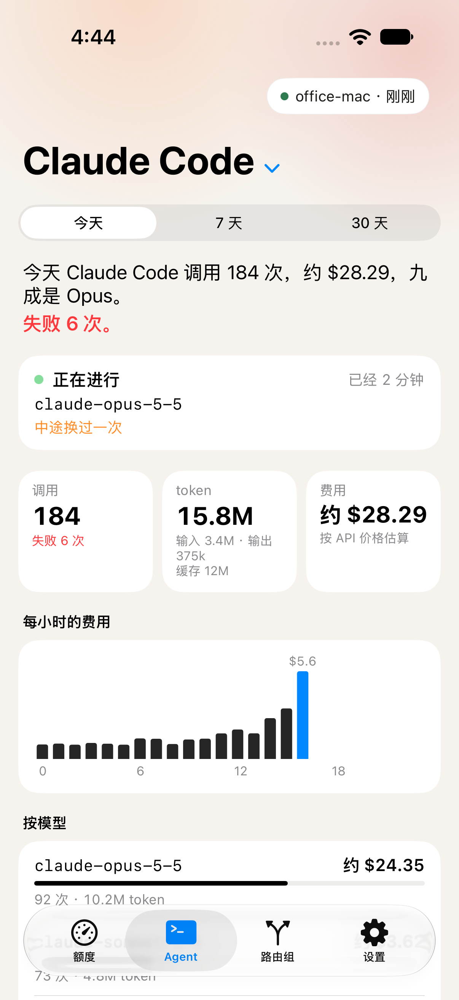

# Perch

[](LICENSE)


**Perch 是 [magpie](https://github.com/yetone/magpie) 的 iPhone 遥控器。** 额度一眼看清，模型随手调。

当前版本：**1.5** · [English](#english)

Perch 通过局域网（或你自己的 VPN / Tailscale 等）连到你电脑上运行的 magpie 网关，用 magpie 的密钥读取数据，让你在手机上：

- **额度**：看每个订阅账号（Claude、Kimi……）各窗口还剩多少、什么时候重置，以及照现在的速度大约什么时候用完；停用 / 启用账号。
- **Agent**：看 Claude Code、Codex、OpenCode 等 Agent 今天 / 7 天 / 30 天的调用次数、token、估算费用、失败原因，以及正在进行的调用。
- **路由组**：查看并修改 magpie 的路由组：调整顺序、设首选、切换路由方式。
- **多台电脑**：保存多台运行 magpie 的电脑，随时切换。
- **网络慢也看得到**：每台电脑上次读到的数据先显示出来，顶部的胶囊写着数据是什么时候读的；读得慢、某一块没读到、整页没读到、连不上电脑，都有各自的提示和重试。

> Perch 是独立的社区项目，和 magpie 官方无关。

<p align="center">
  
  
  
</p>

截图中的账号、邮箱和数据都是 Debug 版本内置的演示数据（`-perch-demo`），不是真实账号。

## 版本要求

| 组件 | 要求 |
| --- | --- |
| iOS | 26.0 及以上（iPhone） |
| Xcode | 26 及以上（Swift 6） |
| magpie | 需要带路由组管理 API 的版本，开发时最早用的是 0.1.4260；0.1.4283 起 magpie 会告诉 Perch 自己的版本，Perch 才能显示版本和新版本提示 |

开发过程中先后在 magpie 0.1.4260、0.1.4266、0.1.4283 上测试过，1.5 的端到端测试跑在 0.1.4337 上（都是 macOS）。这只是开发记录，不是兼容承诺。更旧或更新的版本可能能看额度，但用量、路由组等功能可能读不到（magpie 返回 404 时 Perch 会显示错误）。

## 自己构建和签名

Perch 不在 App Store 上架，需要你用自己的 Apple 开发者账号构建（免费的 Personal Team 也可以装到自己的手机上）。

1. 克隆仓库：

   ```sh
   git clone https://github.com/bulai0408/Perch.git
   cd Perch
   ```

2. 复制本地签名配置（这个文件已被 gitignore，不会被提交）：

   ```sh
   cp Config/Local.example.xcconfig Config/Local.xcconfig
   ```

   然后编辑 `Config/Local.xcconfig`：

   ```
   PERCH_BUNDLE_ID = com.yourname.perch   // 一个属于你的 bundle id
   DEVELOPMENT_TEAM = YOURTEAMID          // 你的 Team ID（Xcode → Settings → Accounts）
   ```

   不创建这个文件也能编译到模拟器（使用占位的 `com.example.perch`），但装到真机必须填写。

3. 用 Xcode 打开 `Perch.xcodeproj`，选择 `Perch` scheme 和你的 iPhone，运行即可。也可以用命令行：

   ```sh
   xcodebuild -project Perch.xcodeproj -scheme Perch \
     -destination 'platform=iOS Simulator,name=iPhone 17' build
   ```

签名相关的所有设置都在 `Config/Perch.xcconfig`（提交到仓库，只有占位值）和 `Config/Local.xcconfig`（你自己的，不提交）里，`project.pbxproj` 里不含任何个人信息。

## 连接你自己的 magpie

Perch 的「添加电脑」页里有同样的步骤，按 magpie「网关」页上的顺序来：

1. 在电脑上打开 magpie，点左边的「网关」。
2. 在「局域网共享」那一行，点「局域网」。magpie 默认端口是 `3425`。
3. 在「网关密钥」右边点「添加网关密钥」，名字随便填（比如 手机），「自定义密钥（可选）」空着，点「创建」。
4. 在「网关」页复制标着「局域网」的那条地址，粘到 Perch 的「地址」里。不要用标着「本机」的那条。
5. 点这把密钥那一行的复制按钮，粘到 Perch 的「密钥」里，点「连接」。

地址的写法：

- 局域网地址（例如 `http://192.168.1.20:3425`、`http://my-mac.local:3425`），或 Tailscale 地址（`100.x.y.z`，或 MagicDNS 名字，例如 `http://my-mac.tailnet.ts.net:3425`）。
- 不写 `http://` 和端口时默认 `http://…:3425`；从 magpie 复制来的地址末尾带着 `/v1` 也可以，Perch 会自动去掉。

想在手机上改路由组：在这把密钥那一行点 ⋯ →「高级」→「管理 API」，选「任何电脑均可」。不开也能连上和看额度，只是不能修改路由组。

连不上时，Perch 会在表单下面列出要检查的几项：

- 局域网：手机和电脑在同一个 Wi-Fi 上；「局域网共享」选的是「局域网」；用的是标着「局域网」的地址；电脑的防火墙没拦住 magpie。
- Tailscale：手机和电脑都开着 Tailscale、登的是同一个账号；电脑上的 Tailscale 允许别的设备连进来；「局域网共享」选的是「局域网」；电脑的防火墙对 Tailscale 也放行了 magpie。

说明：

- 密钥只保存在手机的钥匙串（Keychain）里，界面上永远只显示最后 4 位。
- magpie 用的是 HTTP，因此 `Config/Info.plist` 开启了 `NSAllowsArbitraryLoads`。1.5 去掉了 `NSAllowsLocalNetworking`：有它时 iOS 只放行局域网地址，Tailscale 的 HTTP 地址会被拦下。第一次连接时 iOS 会请求「本地网络」权限，需要允许。
- 请只在可信的网络（家庭 / 办公局域网、Tailscale 等 VPN）里使用。不要把 magpie 端口直接暴露到公网。

## 开发与测试

- 单元测试（不需要 magpie）：

  ```sh
  xcodebuild test -project Perch.xcodeproj -scheme Perch \
    -destination 'platform=iOS Simulator,name=iPhone 17' \
    -skip-testing:PerchUITests
  ```

- 端到端测试 `scripts/e2e.sh`：在 Mac 上下载最新的 magpie CLI，在临时 HOME 里启动一个一次性的 magpie 和几个假的上游，再跑 `PerchUITests`。它**不会**读取或修改你自己的 magpie。需要 Apple silicon Mac、Xcode 和 iOS 模拟器，大约 15 分钟。可用的环境变量：

  | 变量 | 作用 | 默认值 |
  | --- | --- | --- |
  | `PERCH_E2E_ARTIFACTS` | 日志、`.xcresult`、截图的输出目录 | `./build/e2e` |
  | `PERCH_E2E_PORT` | 一次性 magpie 的端口 | `3430` |
  | `PERCH_E2E_DESTINATION` | `xcodebuild -destination` | `platform=iOS Simulator,name=iPhone 17` |
  | `MAGPIE_BIN` | 使用本地的 magpie 可执行文件，而不是下载 | 下载最新 release |
  | `XCODEBUILD` | 测试命令 | `xcodebuild` |

- 想让 UI 测试连**你自己的** magpie，可以不用脚本，直接给 `xcodebuild test` 传环境变量（`TEST_RUNNER_` 前缀会被 xcodebuild 去掉后传给测试）：
  `TEST_RUNNER_PERCH_E2E_ADDRESS`、`TEST_RUNNER_PERCH_E2E_KEY`（可看额度 + 管理 API）、`TEST_RUNNER_PERCH_E2E_VIEW_KEY`（只可看额度）。注意：UI 测试会**修改**路由组 `coder`，请只对测试用的 magpie 这样做。
- Debug 版本支持 `-perch-demo` 启动参数（或环境变量 `PERCH_DEMO=1`），用内置的演示数据填满所有页面，方便截图和开发 UI，不需要 magpie。Release 版本不包含这些代码。
- Debug 版本还可以用环境变量模拟慢网络：`PERCH_NET_DELAY_MS`（每个请求先等一会儿）、`PERCH_NET_FAIL=offline|timeout`、`PERCH_NET_FAIL_PATHS`（只让某些路径失败）、`PERCH_NET_FAIL_FOR_S`（启动多少秒后恢复）。说明见 `Perch/Debug/NetworkHook.swift`。
- `scripts/shots.sh`：在演示数据上截图（iPhone Pro 和 SE 尺寸，浅色 / 深色），输出到 `PERCH_SHOTS_ARTIFACTS`（默认 `./build/shots`）。
- `scripts/upgrade.sh`：升级检查。`OLD_REV=<旧版本的 git 提交> scripts/upgrade.sh` 先装旧版本并保存数据，再把当前版本装上去启动，输出到 `PERCH_UPGRADE_ARTIFACTS`（默认 `./build/upgrade`）。

详见 [CONTRIBUTING.md](CONTRIBUTING.md)。

## 参与贡献

欢迎提 Issue 和 Pull Request，请先阅读 [CONTRIBUTING.md](CONTRIBUTING.md) 和 [行为准则](CODE_OF_CONDUCT.md)。安全问题请按 [SECURITY.md](SECURITY.md) 私下报告，不要公开提 Issue。

## 许可证

[MIT](LICENSE) © 2026 Perch contributors

---

## English

**Perch is an iPhone remote for [magpie](https://github.com/yetone/magpie).** Check your quotas at a glance and switch models on the go.

Current version: **1.5**.

Perch connects to the magpie gateway running on your computer, over your LAN or your own VPN, and authenticates with a magpie gateway key. It lets you:

- **Quotas (额度)**: see what's left in each subscription account's windows, when they reset and when they'll run out at the current pace. You can also switch accounts on or off.
- **Agent**: see calls, tokens, estimated cost, failures and live calls per agent (Claude Code, Codex, OpenCode…) for today, 7 days or 30 days.
- **Routing groups (路由组)**: view and change magpie's routing groups: reorder members, set the first choice, change the routing mode.
- **Several computers**: save more than one magpie computer and switch between them.
- **Slow networks**: each computer's last data shows first, and the status capsule says when it was read. Slow loads, a block that didn't load, a page that didn't load and an unreachable computer each get their own notice and retry.

The UI is in Simplified Chinese. Perch is an independent community project, not affiliated with magpie. The accounts in the screenshots are built-in demo data (`-perch-demo`).

### Requirements

- iOS 26.0+ (iPhone), Xcode 26+ (Swift 6).
- A magpie build with the routing-group admin API; the earliest version used during development was 0.1.4260. From 0.1.4283 magpie reports its version, which Perch needs to show the version and update hints.
- During development Perch was tested against magpie 0.1.4260, 0.1.4266 and 0.1.4283, and the 1.5 end-to-end run used 0.1.4337 (all on macOS). This is a record of development, not a compatibility promise.

### Build and sign it yourself

Perch isn't on the App Store, so you build it with your own Apple developer account. A free Personal Team works.

```sh
git clone https://github.com/bulai0408/Perch.git
cd Perch
cp Config/Local.example.xcconfig Config/Local.xcconfig   # gitignored
```

Set `PERCH_BUNDLE_ID` (a bundle id you own) and `DEVELOPMENT_TEAM` (your team id) in `Config/Local.xcconfig`. Then open `Perch.xcodeproj`, pick the `Perch` scheme and your iPhone, and run.

Simulator builds work without `Local.xcconfig`, using the placeholder `com.example.perch`. No personal signing values live in the project file. `Config/Perch.xcconfig` holds the placeholders and includes your optional `Local.xcconfig`.

### Connect your own magpie

Perch's Add computer screen walks through the same steps, in the order of magpie's Gateway (网关) page:

1. Open magpie on your computer and click **Gateway (网关)** on the left.
2. In the **LAN sharing (局域网共享)** row, choose **LAN (局域网)**. The default port is `3425`.
3. Next to **Gateway keys (网关密钥)**, click **Add gateway key (添加网关密钥)**, give it any name, leave the custom key empty and click **Create (创建)**.
4. Copy the address labelled **LAN (局域网)** on the Gateway page into Perch's **Address (地址)** field. Not the one labelled **This computer (本机)**.
5. Copy the key from its row into Perch's **Key (密钥)** field and tap Connect.

Addresses can be a LAN address (`http://192.168.1.20:3425`, `http://my-mac.local:3425`) or a Tailscale address (`100.x.y.z`, or a MagicDNS name such as `http://my-mac.tailnet.ts.net:3425`). Without a scheme and port Perch uses `http://…:3425`, and a trailing `/v1` copied from magpie is accepted and dropped.

To change routing groups from the phone: in the key's row, ⋯ → Advanced (高级) → **Admin API (管理 API)**, choose **Any computer (任何电脑均可)**.

If Perch can't connect, it lists what to check below the form, one list for LAN addresses (same Wi-Fi, LAN sharing on, the LAN address, the firewall) and one for Tailscale (Tailscale on and signed in to the same account on both devices, incoming connections allowed on the computer, LAN sharing on, the firewall lets Tailscale through).

The key is stored only in the iOS Keychain and is never shown in full. magpie serves plain HTTP, so `Config/Info.plist` allows arbitrary loads. 1.5 dropped `NSAllowsLocalNetworking`, which made iOS allow only LAN addresses and block plain-HTTP Tailscale addresses. iOS asks for Local Network access on first connect. Use Perch only on networks you trust (your LAN, Tailscale or another VPN). Don't expose magpie's port to the internet.

### Development and tests

- Unit tests (no magpie needed): `xcodebuild test -project Perch.xcodeproj -scheme Perch -destination 'platform=iOS Simulator,name=iPhone 17' -skip-testing:PerchUITests`
- `scripts/e2e.sh` is the end-to-end test, taking about 15 minutes. It downloads the latest magpie CLI and runs a **throwaway** magpie with fake upstreams under a temporary HOME. Then it runs `PerchUITests` against it. It never touches your own magpie. It is configured through the `PERCH_E2E_ARTIFACTS`, `PERCH_E2E_PORT`, `PERCH_E2E_DESTINATION`, `MAGPIE_BIN` and `XCODEBUILD` environment variables (table above).
- To run the UI tests against a magpie of your own, pass `TEST_RUNNER_PERCH_E2E_ADDRESS`, `TEST_RUNNER_PERCH_E2E_KEY` (quotas + admin API) and `TEST_RUNNER_PERCH_E2E_VIEW_KEY` (quotas only) to `xcodebuild test`. Do this only with a test magpie: the tests **change** the `coder` routing group.
- Debug builds accept `-perch-demo` (or `PERCH_DEMO=1`), which fills every tab with built-in demo data with no magpie needed. That code is compiled out of Release builds.
- Debug builds can simulate a slow network with `PERCH_NET_DELAY_MS`, `PERCH_NET_FAIL=offline|timeout`, `PERCH_NET_FAIL_PATHS` and `PERCH_NET_FAIL_FOR_S` (see `Perch/Debug/NetworkHook.swift`).
- `scripts/shots.sh` takes screenshots on demo data (iPhone Pro and SE size, light and dark) into `PERCH_SHOTS_ARTIFACTS` (default `./build/shots`). `OLD_REV=<git rev> scripts/upgrade.sh` installs an older build, saves state, installs this build over it and launches it (`PERCH_UPGRADE_ARTIFACTS`, default `./build/upgrade`).

See [CONTRIBUTING.md](CONTRIBUTING.md). Report security issues privately as described in [SECURITY.md](SECURITY.md).

### License

[MIT](LICENSE) © 2026 Perch contributors
